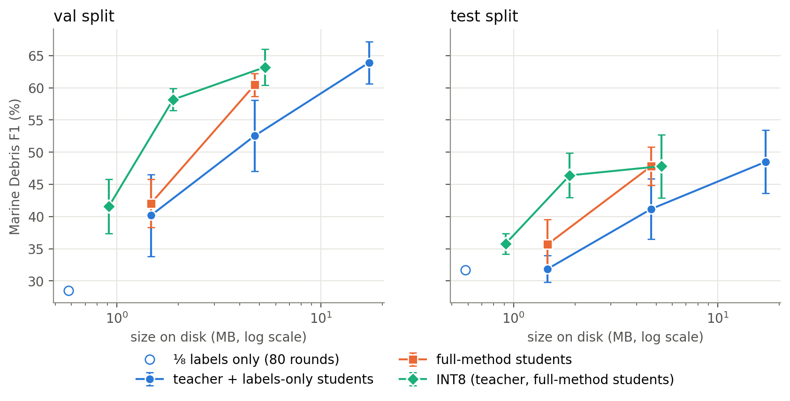

# How Small Can a Marine Debris Segmenter Be? Compressing MariNeXt with Distillation on Unlabelled Pixels and 8-bit Quantization

**Javin Chutani (24117014), Jashan Aneja (24117013)**
Department of Computer Science and Engineering, Dr B R Ambedkar National Institute of Technology Jalandhar
Guide: [name]

*Draft, 8 November 2026. Every number in this draft comes from a run in the project repository; the source file
for each table is given in its caption. Items marked [verify] or [REF] must be checked or filled in before submission.*

---

## Abstract

Floating marine debris covers a very small share of the pixels in Sentinel-2 images, and in the MADOS dataset
about 99% of all pixels carry no label. We study what happens to debris detection when the MariNeXt segmentation
model (4.24 M parameters) is made smaller, and whether a teacher model can help a small model, including on the
unlabelled pixels that normal training ignores. We first reproduce the released MariNeXt checkpoints (test
debris F1 51.3 with test-time augmentation, equal to the published value). We then train width-scaled students
with ½, ¼ and ⅛ of the channels. In these students, debris and other rare classes lose accuracy much faster than
the common water classes. Training small students for twice as many epochs as the original recipe was the largest
single improvement we found. With 160 epochs and three seeds, a half-width student (1.13 M parameters) trained
with class-weighted distillation on both labelled and confident unlabelled pixels reaches a debris F1 of
60.4 ± 1.8 on validation and 47.8 ± 3.0 on test, against 52.5 ± 5.5 and 41.2 ± 4.7 for the same student trained
on labels only. The teacher scores 63.9 ± 3.3 and 48.5 ± 4.9. The gain is consistent across seeds, but a much
simpler change, doubling the loss weight of the debris class, gives the same validation score (61.1 ± 3.8); it
is lower on test (42.0 ± 0.6). Either distillation term alone gives a smaller gain that is within seed noise.
At quarter width (0.32 M parameters) none of the methods differs clearly from label-only training. Plain 8-bit
post-training quantization also hurts debris far more than other classes (−17.1 debris F1 on validation for the
teacher), but percentile calibration with the first and last convolution kept in 32-bit removes almost all of the
loss (−0.7). The 8-bit half-width student is a 1.9 MB file and runs in 22 ms per image on one laptop CPU core.

---

## 1. Introduction

Marine litter that floats at the sea surface can be seen in Sentinel-2 images, and recent work has trained deep
segmentation models to map it together with other sea-surface features [1]. MariNeXt, introduced with the MADOS
dataset, is one such model. It is based on the SegNeXt design [4] and segments 15 classes, one of which is
marine debris.

Running such a model on board a satellite would allow the satellite to send down only the scenes that contain
debris. On-board hardware, however, works at a few watts. ESA's Φ-Sat-1 mission ran a convolutional network on a
low-power vision processor [REF, verify], and the Edge SpAIce project reports FPGA deployment of models with around
100 thousand parameters, with a target of 0.5–1 M parameters [7]. MariNeXt has 4.24 M parameters, so it would have
to be made several times smaller.

Making a model smaller does not reduce accuracy evenly across classes. Classes with few training pixels tend to
suffer first. In MADOS, marine debris makes up 0.34% of the labelled training pixels, and 99.1% of all training
pixels have no label at all (Section 3). A compressed model therefore has little direct evidence to learn debris
from. Knowledge distillation [5] lets a large teacher pass on what it has learned to a smaller student. With sparse
labels, the teacher can also be run on the unlabelled pixels, which supervised training does not use.

This paper asks two questions:

1. How does debris detection change, compared with the other classes, as MariNeXt is made narrower or stored in
   8 bits?
2. Does distillation from the full model, and in particular distillation on the teacher's confident predictions for
   unlabelled pixels, keep debris detectable in a smaller model better than training on labels alone or simply
   up-weighting debris in the loss?

Our contributions are modest and empirical:

- a reproduction of the released MariNeXt checkpoints on MADOS that matches the published debris scores;
- a controlled comparison of width-scaled students (½, ¼, ⅛) with per-class results, showing which classes degrade
  first;
- a distillation loss that adds a confidence-weighted term on unlabelled pixels, and an ablation with three seeds
  at half and quarter width, including a simple class-reweighting baseline;
- an analysis of how reliable the teacher is when it is confident, and of what the unlabelled-pixel term actually
  sees;
- an 8-bit post-training quantization study that shows the same "rare classes first" pattern and a setting chosen
  on validation that removes most of the loss.

We report negative and mixed results as they came out. In particular, the proposed method does not clearly beat a
simple class-reweighting baseline on validation data.

## 2. Related work

**Marine debris and MADOS.** Kikaki et al. [1] released MADOS, a Sentinel-2 dataset with sparse pixel labels for
marine pollutants and sea-surface features, and MariNeXt, a SegNeXt-style [4] network trained on it. Their training
recipe includes class-weighted cross-entropy and a copy-paste style augmentation on labelled pixels (Section 4.4).
Our teacher is their released model.

**Knowledge distillation.** Hinton et al. [5] train a small network to match the softened output distribution of a
larger one. For dense prediction, distillation is usually applied at every pixel [REF]. Using a teacher's
predictions on unlabelled data is closely related to pseudo-labelling and self-training in semi-supervised
segmentation [REF]. We do not convert teacher outputs to hard labels; we use them only as soft targets, weighted by
the teacher's confidence.

**Compression for on-board use.** The Edge SpAIce project [7] distils MariNeXt for FPGA deployment. Our work
differs in its focus: we measure where debris accuracy breaks under compression, class by class, and we test a
distillation term on unlabelled pixels. We do not deploy to an FPGA. For quantization we use standard post-training
static quantization with integer arithmetic [REF: Jacob et al., CVPR 2018, verify] as implemented in ONNX
Runtime [8].

## 3. Data

We use MADOS [1, 3] exactly as distributed, with the official train, validation and test splits and the official
data loader. Each sample is a 240 × 240 patch with 11 Sentinel-2 bands (442–2186 nm, resampled to 10 m), with
missing values replaced by the band mean and each band standardised with the official constants.

**Table 1. MADOS splits and labels** (`results/data_report.md`).

| | train | validation | test |
|---|---|---|---|
| patches | 1,433 | 642 | 728 |
| patches containing debris | 250 | 98 | 124 |
| labelled pixels | 761,887 | 358,121 | 361,147 |
| debris pixels | 2,561 | 1,162 | 973 |
| unlabelled share of all pixels | 99.08% | 99.03% | 99.14% |

The label set has 15 classes. They are very unbalanced: in the training split, Marine Water, Sediment-Laden Water
and Oil Spill together make up 73.9% of labelled pixels, while Marine Debris has 0.34%, and Foam, Natural Organic
Material and Jellyfish each have under 0.2%. Unlabelled pixels carry the ignore index (−1) and are excluded from
the supervised loss and from every metric in this paper.

The test split contains only 973 debris pixels, so debris scores on test change by several points between runs.
The five released teacher checkpoints, for example, span 44.3–56.0 debris F1 on test (Table 3).

## 4. Method

### 4.1 Teacher

The teacher is MariNeXt with the official configuration: an MSCAN-Tiny encoder (embedding widths 32-64-160-256,
depths 3-3-5-2) and a LightHam decoder with 256 channels, 4,238,063 parameters in total. The authors released five
trained checkpoints. We evaluate all five. For distillation we use checkpoint 5, the checkpoint with the highest
validation debris F1 (69.1 single pass); test scores played no part in this choice. The teacher is frozen during
student training.

### 4.2 Students

A student is the same network with every channel width multiplied by a factor *m*. Encoder widths become
(32, 64, 160, 256) × *m*, and the decoder width becomes 256 × *m*. Depths, MLP ratios, the 11 input bands and the
15 output classes are unchanged. Table 2 lists the sizes. We count parameters directly from the built models.

**Table 2. Model sizes** (`results/efficiency.md`, `results/headline.md`). GMACs for one 11 × 240 × 240 input;
size is the 32-bit PyTorch state dict in MB (10⁶ bytes).

| model | width | parameters | GMACs | size (MB) |
|---|---|---|---|---|
| teacher | 1 | 4,238,063 | 2.243 | 17.18 |
| student | ½ | 1,130,751 | 0.600 | 4.73 |
| student | ¼ | 318,311 | 0.170 | 1.47 |
| student | ⅛ | 97,395 | 0.052 | 0.58 |

### 4.3 Loss

For each training batch the teacher (in eval mode, no gradient) and the student see the same augmented input.
Let *t* and *s* be their logits, *y* the labels, "lab" the labelled pixels and "ign" the unlabelled ones. With
temperature *T*:

- per-pixel distillation loss: kl(x) = T² · Σ_c p_t,c(x) · (log p_t,c(x) − log p_s,c(x)), with p = softmax(logits / T);
- teacher confidence: c(x) = max_c softmax(t(x))_c, at T = 1;
- confidence weight: w(x) = clamp((c(x) − τ) / (1 − τ), 0, 1), so pixels below the threshold τ get weight 0;
- debris weight: d(x) = debris_w if the teacher's top class is debris, otherwise 1.

The total loss is

L = L_sup + λ_L · KD_lab + λ_U(epoch) · KD_ign,

where L_sup is the official weighted cross-entropy (Section 4.4) and

- KD_lab is the mean of kl over labelled pixels;
- KD_ign is the mean of w · d · kl over unlabelled pixels with w > 0.

λ_U rises linearly from 0 over the first 5 epochs. Teacher outputs on unlabelled pixels are never turned into hard
labels.

**Class-weighted variant.** Our first runs used plain means for both distillation terms, and they lowered debris
F1 (Section 6.3). The supervised loss weights a debris pixel about ten times more than a water pixel, but the plain
distillation means weight every pixel equally, and about 90% of the teacher's confident unlabelled pixels are
Marine Water (Section 6.6). We therefore use class-weighted means: each pixel's distillation loss is multiplied by
the official class weight of its true class (labelled pixels) or of the teacher's top class (unlabelled pixels),
and divided by the sum of those weights. This is a change from our original plan and we report it as such. All
distillation results in Sections 6.4–6.5 use this variant.

### 4.4 Training recipe

We use the official MariNeXt training script and settings:

- Adam, learning rate 2 × 10⁻⁴, no weight decay, batch size 5;
- learning rate multiplied by 0.1 at fixed epochs;
- an exponential moving average (EMA) of the weights with decay 0.999;
- cross-entropy with class weights w_c = 1 / ln(1.03 + f_c), where f_c is the class frequency;
- random flips and 90° rotations;
- the official copy-paste augmentation (VSCP), which copies the labelled pixels of one image in the batch onto
  another and adds the result to the batch.

The official recipe trains for 80 epochs with learning-rate steps at epochs 45 and 65. The quarter-width student was
still improving at epoch 80 (Section 6.2), so **all students in the main experiments train for 160 epochs with
steps at epochs 90 and 130** (the same proportions). This is a deliberate change from the official recipe and
applies equally to every student setting compared.

The official script does not select a checkpoint. We keep the EMA weights from the epoch with the best validation
macro-F1. We do not select on debris F1 because the validation split has only 1,162 debris pixels, and selecting
on it would favour the debris-targeted settings. Each run sets and logs its seed, and every main setting is run
with seeds 0, 1 and 2. For the distillation runs, the teacher's forward pass is isolated from the student's random
number stream, so a distillation run and a label-only run with the same seed see the same data order and
augmentation. In a check, the training losses of a label-only run and a distillation run with both weights set to
zero agreed only to about five significant digits, not bit for bit; we did not find the cause.

### 4.5 Settings compared

All settings below use the same split, bands, recipe, model selection rule and evaluation code.

| setting | description |
|---|---|
| labels only (B) | official supervised loss only |
| debris ×2 (C) | as B, with the debris class weight in the cross-entropy multiplied by 2 (no teacher) |
| KD labelled (D2) | B + class-weighted distillation on labelled pixels; λ_L = 0.5, λ_U = 0, T = 1 |
| KD unlabelled (E2) | B + class-weighted distillation on unlabelled pixels; λ_L = 0, λ_U = 0.5, T = 1, τ = 0.8, debris_w = 1 |
| full method (F2) | B + both terms; λ_L = λ_U = 0.5, T = 1, τ = 0.8, debris_w = 2 |

The distillation settings (T, λ, τ, debris_w) were fixed after a single-seed pilot at quarter width and were not
tuned further. Note that F2 also up-weights debris in the unlabelled term (debris_w = 2), so F2 is not exactly the
sum of D2 and E2.

### 4.6 8-bit quantization

We export each model to ONNX (opset 13) and apply ONNX Runtime 1.19.2 static post-training quantization in the
quantize-dequantize format:

- convolution weights are 8-bit per channel, and activations are unsigned 8-bit;
- calibration uses 200 training patches without augmentation;
- the LightHam decoder's matrix-decomposition step stays in 32-bit floating point.

MariNeXt's decoder draws random starting bases on every forward pass, and the official evaluation re-seeds before
each patch. We therefore store these bases as fixed constants, equal to the seed-0 draw. We checked that the
32-bit ONNX model then reproduces the PyTorch outputs; the largest logit difference over all runs was 3 × 10⁻⁵.

Quantization settings were compared on the validation split only, using teacher checkpoint 1:

- "plain": min-max calibration;
- reduced weight range;
- symmetric 8-bit activations;
- percentile calibration at 99.999%;
- first and last convolution kept in 32-bit;
- the last two combined ("tuned").

### 4.7 Metrics and measurement

Accuracy is measured on labelled pixels only. We report per-class precision, recall, F1 and IoU, and macro-F1 and
mIoU over the 15 classes. **Debris F1 is the headline metric.** Unless stated otherwise, results are single-pass;
test-time augmentation (TTA, 8 flipped/rotated views with a majority vote) is used only for the teacher
reproduction. Results are mean ± sample standard deviation over seeds (students) or over the five released
checkpoints (teacher). The test split was used only for reporting.

Speed was measured on the laptop that ran all experiments:
- Hardware: an RTX 4060 Laptop GPU (8 GB) and an Intel i7-13620H CPU, under WSL2.
- Training: PyTorch 1.11 with CUDA 11.3, with TF32 disabled.
- CPU latency: ONNX Runtime, batch 1, one 11 × 240 × 240 input, 50 warm-up runs and 200 timed runs, repeated 3
  times, median reported.

## 5. Teacher reproduction

**Table 3. Released MariNeXt checkpoints, marine debris** (`results/teacher_repro.md`). Mean ± sd over 5
checkpoints. The paper values are from [1], Table 5.

| split | mode | F1 | recall | IoU |
|---|---|---|---|---|
| validation | single | 63.9 ± 3.3 | 74.6 ± 2.0 | 47.0 ± 3.6 |
| validation | TTA | 67.3 ± 3.4 | 77.9 ± 1.6 | 50.8 ± 4.0 |
| test | single | 48.5 ± 4.9 | 67.8 ± 3.0 | 32.1 ± 4.4 |
| test | TTA | 51.3 ± 4.1 | 70.4 ± 3.1 | 34.6 ± 3.8 |
| test (paper [1]) | TTA, mean of 5 | 51.3 | 70.4 | 34.6 |

- **Agreement with the paper.** Our test TTA scores match the published debris F1, recall and IoU to one decimal.
  Our evaluation code also gives the same numbers as the authors' evaluation script when TF32 is left at the
  PyTorch default.
- **Effect of TF32.** With TF32 disabled, as in all our runs, a few pixels change, by at most 0.3 points per class
  on checkpoint 1.
- **Checkpoint spread.** Per checkpoint, test debris F1 (single) ranges from 44.3 to 56.0.
- **Basis for comparisons.** All later comparisons use single-pass scores, so the teacher reference is
  63.9 ± 3.3 (validation) and 48.5 ± 4.9 (test).

## 6. Results

### 6.1 Where small models lose accuracy

With the official 80-epoch recipe and labels only (seed 0, `results/width_sweep.md`), validation debris F1 falls
from 63.9 (teacher mean) to:

- ½ width: 41.5;
- ¼ width: 29.8;
- ⅛ width: 28.5.

At ½ width the common classes change little while debris drops by 22 points.

Table 4 shows the per-class picture for the students trained for 160 epochs (three seeds each) and for the 80-epoch
⅛ student.
- **Half width, labels only.** The largest validation drops are in Waves & Wakes (−17.5), Marine Debris (−11.4) and
  Sea snot (−10.1). The large water classes stay within 3 points.
- **Quarter width.** Many more classes collapse: Shallow Water (−37.5), Waves & Wakes, Foam, Jellyfish and Dense
  Sargassum each lose 20–36 points, and debris loses 23.7.
- **Eighth width** (80 epochs). Six of the fifteen classes get an F1 of zero on validation.

So **debris is one of the first classes to break, but not the only one**: classes with few labelled pixels lose
accuracy first.

**Table 4. Validation F1 per class, change against the teacher in brackets** (`results/perclass.md`; test split in
the same file). Classes sorted by number of labelled validation pixels.

| class | val px | teacher | ½ labels only | ½ full method | ¼ labels only | ¼ full method | ⅛ labels only (80 ep.) |
|---|---|---|---|---|---|---|---|
| Sediment-Laden Water | 125,565 | 99.5 | 99.8 (+0.3) | 100.0 (+0.5) | 98.6 (−0.9) | 95.8 (−3.7) | 61.8 (−37.7) |
| Marine Water | 92,294 | 86.5 | 86.1 (−0.4) | 84.4 (−2.1) | 80.4 (−6.1) | 84.7 (−1.8) | 59.1 (−27.4) |
| Oil Spill | 42,456 | 67.4 | 65.2 (−2.2) | 62.8 (−4.6) | 65.5 (−1.9) | 58.4 (−8.9) | 40.5 (−26.8) |
| Shallow Water | 40,019 | 89.9 | 90.3 (+0.4) | 84.5 (−5.4) | 52.4 (−37.5) | 61.2 (−28.6) | 42.2 (−47.7) |
| Turbid Water | 39,076 | 93.1 | 90.0 (−3.0) | 91.4 (−1.6) | 84.0 (−9.0) | 77.4 (−15.7) | 27.8 (−65.3) |
| Waves & Wakes | 3,998 | 49.6 | 32.1 (−17.5) | 38.8 (−10.8) | 14.2 (−35.4) | 14.4 (−35.2) | 0.0 (−49.6) |
| Oil Platform | 3,923 | 63.3 | 62.2 (−1.1) | 64.9 (+1.6) | 62.5 (−0.8) | 55.4 (−7.9) | 51.5 (−11.8) |
| Ship | 3,740 | 49.1 | 39.8 (−9.3) | 47.9 (−1.2) | 35.9 (−13.2) | 36.6 (−12.5) | 28.5 (−20.6) |
| Sea snot | 2,702 | 87.0 | 77.0 (−10.1) | 82.4 (−4.7) | 70.7 (−16.3) | 69.5 (−17.5) | 36.4 (−50.6) |
| Dense Sargassum | 1,167 | 81.6 | 88.8 (+7.2) | 63.3 (−18.3) | 61.1 (−20.5) | 61.6 (−20.0) | 0.0 (−81.6) |
| **Marine Debris** | 1,162 | 63.9 | 52.5 (−11.4) | 60.4 (−3.5) | 40.2 (−23.7) | 42.0 (−21.9) | 28.5 (−35.4) |
| Jellyfish | 928 | 89.0 | 87.3 (−1.6) | 93.4 (+4.5) | 63.7 (−25.2) | 58.0 (−30.9) | 0.0 (−89.0) |
| Sparse Floating Algae | 627 | 63.7 | 69.6 (+5.9) | 60.2 (−3.4) | 45.9 (−17.8) | 49.6 (−14.0) | 0.0 (−63.7) |
| Foam | 369 | 89.9 | 89.0 (−0.9) | 93.6 (+3.7) | 62.8 (−27.1) | 59.7 (−30.2) | 0.0 (−89.9) |
| Natural Organic Material | 95 | 12.8 | 8.2 (−4.6) | 3.9 (−8.9) | 1.1 (−11.8) | 1.2 (−11.6) | 0.0 (−12.8) |

### 6.2 Small students need longer training

At quarter width with labels only (seed 0, `results/kd_pilot.md`), the best validation epoch under the 80-epoch
recipe was the last one. Training for 160 epochs, with the learning-rate steps moved to epochs 90 and 130, raised:
- validation debris F1 from 29.8 to 44.5;
- validation macro-F1 from 42.6 to 60.5.

At half width, the 160-epoch label-only student reached 52.5 ± 5.5 validation debris F1 over three seeds; the
80-epoch seed-0 run had 41.5.

Longer training was the largest single gain we observed, and it applies to every setting below. One consequence is
that the 80-epoch results in Section 6.1 understate what the small architectures can do. The ⅛ student was not
retrained for 160 epochs.

### 6.3 Plain distillation hurt debris

In a single-seed pilot at quarter width with 80 epochs (`results/kd_pilot.md`), distillation with plain
(unweighted) means and T = 2, λ_L = λ_U = 1 lowered validation debris F1 below the label-only student (29.8):

| setting (plain KD, 80 epochs) | validation debris F1 |
|---|---|
| teacher on labelled pixels (D) | 15.9 |
| teacher on unlabelled pixels (E) | 25.7 |
| both, with debris weighting (F) | 10.1 |

Only the debris ×2 baseline improved, to 38.8. This led to the class-weighted variant in Section 4.3, with
T = 1 and λ = 0.5.

### 6.4 Three-seed comparison at half width

Table 5 gives all five settings at half width, 160 epochs, seeds 0–2.

**Table 5. Half width (1.13 M parameters), marine debris, mean ± sd over 3 seeds** (`results/seeds_w0.5.md`).
Macro-F1 is over all 15 classes. Δ is the paired difference to labels only (same seed); "wins" counts seeds where
debris F1 is higher than labels only.

| setting | val F1 | val recall | val precision | val macro-F1 | test F1 | test macro-F1 | Δ debris F1 val / test | wins val / test |
|---|---|---|---|---|---|---|---|---|
| labels only | 52.5 ± 5.5 | 68.2 ± 3.8 | 42.8 ± 5.7 | 69.2 ± 2.7 | 41.2 ± 4.7 | 58.4 ± 8.4 | – | – |
| debris ×2 | **61.1 ± 3.8** | 82.2 ± 3.6 | 48.7 ± 4.0 | 70.1 ± 2.3 | 42.0 ± 0.6 | 62.8 ± 2.6 | +8.6 ± 9.3 / +0.8 ± 5.0 | 3/3, 1/3 |
| KD labelled | 55.0 ± 6.4 | 62.0 ± 6.3 | 49.5 ± 6.3 | 65.6 ± 2.3 | 41.9 ± 6.7 | 61.5 ± 3.7 | +2.5 ± 9.7 / +0.7 ± 9.5 | 2/3, 1/3 |
| KD unlabelled | 56.7 ± 5.9 | 64.0 ± 5.9 | 51.0 ± 6.6 | 67.8 ± 1.3 | 42.5 ± 4.2 | **65.9 ± 1.9** | +4.1 ± 10.6 / +1.3 ± 5.2 | 2/3, 2/3 |
| full method | 60.4 ± 1.8 | 70.5 ± 2.7 | **52.9 ± 1.2** | 68.8 ± 2.1 | **47.8 ± 3.0** | 62.8 ± 4.8 | +7.9 ± 5.1 / +6.6 ± 4.2 | 3/3, 3/3 |
| *teacher (5 ckpts)* | *63.9 ± 3.3* | *74.6 ± 2.0* | *56.1 ± 5.3* | *72.4 ± 1.5* | *48.5 ± 4.9* | *72.6 ± 1.4* | | |

What the table shows:

- **The full method against labels only.** The full method has higher debris F1 than labels only for every seed on
  both splits (+7.9 ± 5.1 validation, +6.6 ± 4.2 test). Its seed-to-seed spread is the smallest of all settings.
  The gain comes mostly from precision (+10.1 validation, +8.2 test); recall changes little (+2.2, −1.3).
- **Each distillation term alone.** Each term alone gives smaller gains (+2.5 and +4.1 on validation, about +1 on
  test), and these are within the seed spread. The unlabelled-pixel term alone is slightly ahead of the
  labelled-pixel term, but the difference is not meaningful with three seeds. The unlabelled-only setting has the
  highest test macro-F1 of the five (65.9 ± 1.9).
- **The debris ×2 baseline.** It matches the full method on validation: paired over seeds, the full method minus
  debris ×2 is −0.7 ± 5.1. It works differently, finding more debris (validation recall 82.2) at lower precision
  (48.7). On test the full method is higher in all three seeds (+5.9 ± 2.8 paired). Settings are chosen on
  validation, and the test split has under a thousand debris pixels. So we do not claim the full method is better
  than the simple baseline; we say it is equal on validation and more consistent, with a better test result.
- **Against the teacher.** On test, the half-width full-method student (47.8 ± 3.0) is within the teacher's spread
  (48.5 ± 4.9). On validation it is 3.5 points below. The student was distilled from checkpoint 5, the strongest
  of the five released checkpoints on validation, while the teacher row is the mean of all five.
- **Other classes.** The full method does not help every class (Table 4, test columns in `results/perclass.md`).
  - At half width it improves Ship, Sea snot and Waves & Wakes over labels only.
  - It lowers Dense Sargassum on both splits (validation 63.3 vs 88.8; test 50.7 vs 64.5).
  - It lowers Oil Spill on test (60.0 vs 70.6).

### 6.5 Three-seed comparison at quarter width

**Table 6. Quarter width (0.32 M parameters), marine debris, mean ± sd over 3 seeds** (`results/seeds_w0.25.md`).
KD-labelled and KD-unlabelled were run with seed 0 only at this width (validation debris F1 44.2 and 40.6), and are
not in the table.

| setting | val F1 | val recall | val precision | test F1 | Δ debris F1 val / test | wins val / test |
|---|---|---|---|---|---|---|
| labels only | 40.2 ± 6.4 | 56.8 ± 8.9 | 31.6 ± 7.3 | 31.9 ± 2.1 | – | – |
| debris ×2 | 41.0 ± 7.0 | 76.2 ± 0.8 | 28.4 ± 6.4 | 29.8 ± 2.1 | +0.9 ± 0.9 / −2.0 ± 1.5 | 3/3, 0/3 |
| full method | 42.0 ± 3.7 | 46.3 ± 3.9 | 38.5 ± 3.7 | 35.7 ± 3.9 | +1.9 ± 5.2 / +3.8 ± 6.0 | 2/3, 2/3 |

At quarter width the full method has the best mean on both splits, but the differences are within seed noise.
It trades recall for precision more strongly than at half width (validation recall −10.5). Debris ×2 shows the
opposite trade-off, and on test it is below labels only for all three seeds. Taken together with Table 5, the
benefit of distillation is clear at half width and small or absent at quarter width.

### 6.6 How reliable is the teacher?

We ran the distillation teacher (checkpoint 5) over the train and validation splits without augmentation
(`results/teacher_reliability.md`). Because the teacher was trained on the train split, validation numbers are the
fair estimate.

- **Confident predictions are mostly right.** On validation, 81.6% of labelled pixels have teacher confidence
  ≥ 0.8, and on those pixels the teacher is correct 96.0% of the time, against 87.3% over all labelled pixels.
  Below 0.8 the accuracy drops quickly: 57.3% for confidence 0.7–0.8, and 40.6% below 0.5. This supports using
  τ = 0.8 as the cut-off.
- **For debris it is precise but cautious.** The teacher is confident on only 32.0% of validation debris pixels.
  Where it is, it is right 96.0% of the time, and its confident debris predictions on labelled pixels are correct
  93.7% of the time.
- **Some classes are confidently wrong.** For Waves & Wakes, the teacher is right on only 4.9% of the validation
  pixels where it is confident, and for Ship only 28.7%. For these classes the unlabelled-pixel term passes on
  wrong evidence.
- **The unlabelled term is dominated by water.** 65.0% of unlabelled validation pixels (71.0% on train) pass the
  0.8 threshold. Of those, the teacher labels 90.2% as Marine Water, 5.4% as Turbid Water, and only 0.02% as
  Marine Debris. Even with class weighting, the term mainly teaches the student how the teacher scores water and
  other common surfaces. It provides little direct evidence about debris.

### 6.7 8-bit quantization

**Table 7. Change in debris F1 from 8-bit quantization (INT8 − FP32, same model, mean ± sd)** (`results/int8.md`).

| model | n | plain, val | plain, test | tuned, val | tuned, test |
|---|---|---|---|---|---|
| teacher (5 checkpoints) | 5 | −17.1 ± 2.0 | −20.7 ± 1.9 | −0.7 ± 0.7 | −0.7 ± 0.7 |
| ¼ full method | 3 | −11.5 ± 4.9 | −11.6 ± 6.6 | −0.4 ± 0.7 | +0.1 ± 5.1 |
| ½ full method | 3 | not run | not run | −2.3 ± 0.1 | −1.4 ± 0.5 |

Plain 8-bit quantization damaged debris much more than the average class. For the teacher, debris F1 fell by
17.1 points on validation while macro-F1 fell by 5.9, and the largest validation drops were in rare classes
(Sparse Floating Algae −35.7, Marine Debris −17.1, Dense Sargassum −14.8). This is the same pattern as in width
reduction.

On validation (teacher checkpoint 1, 32-bit debris F1 60.5), the quantization settings changed debris F1 by:
- reduced weight range: −14.7;
- symmetric 8-bit activations: −26.3;
- percentile calibration: −3.1;
- first and last convolution in 32-bit: −2.5;
- both of the last two ("tuned"): −0.7.

With the tuned setting, the change for the teacher is −0.7 ± 0.7 on both splits, and every class is within
2.3 points of the 32-bit model on validation.

### 6.8 Size and speed

**Table 8. Size, accuracy and CPU latency** (`results/headline.md`). Size is the file on disk (32-bit state dict
or 8-bit ONNX). Latency is ONNX Runtime on the laptop CPU, batch 1, median of 3 × 200 runs.

| model | parameters | size (MB) | debris F1 val | debris F1 test | CPU 1 thread (ms) | CPU 8 threads (ms) |
|---|---|---|---|---|---|---|
| teacher | 4.24 M | 17.18 | 63.9 ± 3.3 | 48.5 ± 4.9 | 63.8 | 27.5 |
| teacher, 8-bit | 4.24 M | 5.31 | 63.2 ± 2.8 | 47.8 ± 4.9 | 46.8 | 25.4 |
| ½ full method | 1.13 M | 4.73 | 60.4 ± 1.8 | 47.8 ± 3.0 | 25.1 | 11.8 |
| ½ full method, 8-bit | 1.13 M | 1.89 | 58.2 ± 1.7 | 46.4 ± 3.4 | 22.1 | 13.2 |
| ¼ full method | 0.32 M | 1.47 | 42.0 ± 3.7 | 35.7 ± 3.9 | 10.7 | 6.4 |
| ¼ full method, 8-bit | 0.32 M | 0.91 | 41.6 ± 4.2 | 35.8 ± 1.6 | 13.1 | 8.4 |

*Figure 1. Validation and test debris F1 against size on disk (log scale)* (`results/fig_size_vs_debris.png`).

- **File size.** 8-bit storage reduces the teacher file by a factor of 3.2. The reduction is smaller for small
  models, because the ONNX file has a fixed overhead of about 0.6 MB.
- **CPU speed.** On the laptop CPU, 8-bit gives only a small speed-up for the teacher and the half-width model. It
  makes the quarter-width model slower: the quantize and dequantize steps and the 32-bit decoder step cost more
  than they save at this size.
- **GPU speed.** On the laptop GPU (PyTorch, `results/efficiency.md`), every width takes 10–15 ms per image,
  because the models are too small to keep the GPU busy. CPU latency is therefore the more useful number for
  low-power hardware, but neither stands in for a real on-board processor.
- **Recommended model.** Among the models we trained, the 8-bit half-width full-method student is the best
  trade-off:
  - 1.89 MB, 9 times smaller than the 32-bit teacher file;
  - 22.1 ms on one CPU thread, against 63.8 ms;
  - debris F1 2.1 (test) to 5.7 (validation) points below the teacher mean.

## 7. Discussion

**Why does the full method help at half width?**
- *What the data show.* The gain is mainly in precision: the student makes fewer false debris detections. The
  teacher-reliability results suggest why. The unlabelled pixels the method uses are almost all water and other
  common surfaces, so the extra signal is mostly about what is not debris. That fits a precision gain better than
  a recall gain.
- *What the data do not show.* We did not test this explanation directly.
- *The ablation.* Each distillation term alone gave a small and noisy gain, and only the combination was consistent
  across seeds.

**Why not at quarter width?** A student with 0.32 M parameters may not have enough capacity to match the
teacher's outputs on both the supervised and the distillation targets. The per-class results at quarter width
show many classes collapsing whatever the training signal. We did not test this explanation directly either.

**Simple class reweighting.** Doubling the debris weight in the cross-entropy is free, needs no teacher, and gave
the same validation debris F1 as the full method at half width. It works mainly by raising recall at the cost of
precision, and its test results were weaker in both widths. Anyone who wants to keep debris in a small model
should consider this baseline first. Which of the two is preferable depends on whether missed debris or false
alarms are more costly.

**Quantization.** Plain post-training quantization showed the same "rare classes first" behaviour as width
reduction. Two standard settings, percentile calibration and keeping the first and last layers in 32-bit, removed
almost all of the loss. Per-class evaluation is needed to catch this: macro-F1 alone understated the damage.

### Limitations

- **Few seeds.** Three seeds per setting is few. Several differences reported here are within seed noise, and we
  have said so where it applies.
- **Small test set.** The test split has 973 debris pixels, and debris F1 on test varies by several points between
  runs, including across the five released teachers.
- **Limited tuning.**
  - The distillation hyperparameters were fixed after one pilot run at quarter width and not tuned at half width.
  - τ was not tuned.
  - Debris ×2 was tested only with factor 2.
  - Other values might change the comparison.
- **Recipe change.** All students were trained for 160 epochs, double the official recipe. This applies equally to
  all compared settings, but it is a departure from the published recipe.
- **Incomplete size range.** The ⅛ student was trained only for 80 epochs and with labels only, so the smallest
  size, the one closest to current FPGA budgets, is not covered by the main experiments.
- **Teacher choice.** The distillation teacher is the strongest of the five released checkpoints on validation;
  a different teacher might give different results.
- **Hardware.** Latency was measured on a laptop CPU and GPU, not on satellite hardware. We did not try FPGA
  deployment, structured pruning, quantization-aware training or feature-level distillation.

## 8. Conclusion

We compressed MariNeXt for marine debris segmentation on MADOS and measured, class by class, what was lost:
- **Rare classes break first.** Narrower models and plain 8-bit quantization both hurt debris and other rare
  classes far more than common water classes.
- **Longer training.** Training small students for longer was the largest single improvement.
- **Distillation at half width.** Class-weighted distillation on labelled and confident unlabelled pixels made a
  half-width student consistently better on debris than label-only training, and close to the teacher on test.
- **Limits of the method.** It did not beat a simple debris-reweighting baseline on validation, and it gave no clear
  gain at quarter width.
- **Quantization.** Tuned 8-bit post-training quantization was nearly lossless.

The resulting 1.9 MB half-width model runs in about 22 ms per image on one laptop CPU thread. Future work should:
- test these models on real low-power hardware;
- focus the unlabelled-pixel term on non-water pixels;
- add more seeds and a larger debris test set.

## Reproducibility

- **Code and runs.** All code, configuration files and per-run logs are in the project repository [repository URL].
  Each run folder records the resolved configuration, seed, software versions, GPU and the git commit.
- **Generated tables.** Tables in this paper are copied from files in `results/`, which are generated by scripts
  from the run folders and are not edited by hand.
- **Environment.** Python 3.8, PyTorch 1.11 (CUDA 11.3), mmcv-full 1.6.0, ONNX 1.17.0, ONNX Runtime 1.19.2. The
  official MariNeXt code is included as a git submodule at a fixed commit.

## Use of AI tools

[State here, as required by the institute's policy, how AI assistants were used in this project — for example for
writing code, running and monitoring experiments, and drafting this text — and that the authors checked all
results and text.]

## References

[1] K. Kikaki, I. Kakogeorgiou, I. Hoteit, K. Karantzalos, "Detecting marine pollutants and sea surface features
with deep learning in Sentinel-2 imagery," *ISPRS Journal of Photogrammetry and Remote Sensing*, vol. 210,
pp. 39–54, 2024.

[2] MADOS / MariNeXt official code, https://github.com/gkakogeorgiou/mados (MIT licence).

[3] MADOS dataset, Zenodo, doi:10.5281/zenodo.10664073.

[4] M.-H. Guo et al., "SegNeXt: Rethinking convolutional attention design for semantic segmentation," in
*Advances in Neural Information Processing Systems (NeurIPS)*, 2022.

[5] G. Hinton, O. Vinyals, J. Dean, "Distilling the knowledge in a neural network," arXiv:1503.02531, 2015.

[6] G. Fang et al., "DepGraph: Towards any structural pruning," in *Proc. IEEE/CVF CVPR*, 2023. [cite only if
pruning is mentioned as future work]

[7] Edge SpAIce project, presentation at the CERN Next Generation Triggers (NGT) meeting, CERN Indico. [verify
exact title, date and URL]

[8] ONNX Runtime, Microsoft, https://onnxruntime.ai. [verify citation format required by venue]

[REF] Missing citations to add and verify:
- the Φ-Sat-1 on-board CNN mission;
- pixel-wise distillation for semantic segmentation;
- self-training / pseudo-labelling for semi-supervised segmentation;
- B. Jacob et al., "Quantization and training of neural networks for efficient integer-arithmetic-only
  inference," CVPR 2018.
